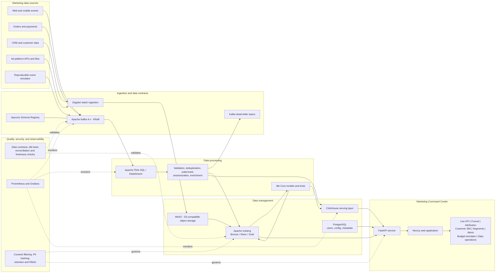
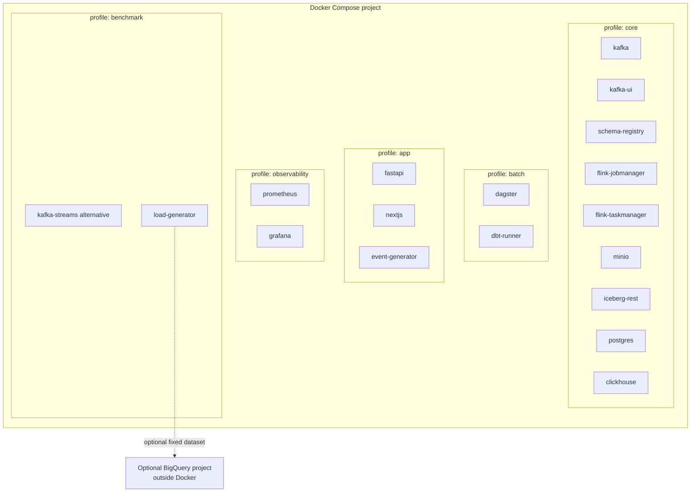

# MarketPulse 360 - High-Level Design

## 1. Architecture decision

MarketPulse 360 is an end-to-end marketing data product composed of:

1. A streaming and batch data engineering platform.
2. A lakehouse that preserves raw and curated historical data.
3. A low-latency analytical serving layer.
4. A Marketing Command Center that proves the processed data is useful.

The recommended core deployment is fully reproducible with Docker Compose:

- Apache Kafka in KRaft mode as the event backbone.
- Apache Flink for stateful stream processing.
- MinIO and Apache Iceberg for the lakehouse.
- ClickHouse for low-latency analytical queries.
- PostgreSQL for application and platform metadata, not as the main analytical warehouse.
- Dagster and dbt Core for scheduled ingestion, orchestration, tests, and batch models.
- FastAPI and Next.js for the application.
- Prometheus and Grafana for platform observability.

BigQuery is an optional cloud benchmark target, not a required runtime dependency.

### Mapping to the course technology categories

The technologies in the project requirements are examples rather than a closed
list (the source document ends both lists with an ellipsis). The report must still
state explicitly which technologies belong to each category:

| Course category | Selected solution | Role in MarketPulse 360 |
|---|---|---|
| Data management | Apache Iceberg + MinIO | Durable lakehouse tables and Bronze/Silver/Gold history |
| Data management | ClickHouse | Columnar analytical serving database for the application |
| Data management | PostgreSQL | Transactional application and platform metadata only |
| Data management alternative | BigQuery/BigLake | Managed cloud warehouse/lakehouse benchmark |
| Data processing | Apache Flink | Main stateful stream-processing engine |
| Data processing alternative | Kafka Streams | Controlled alternative for Kafka-native processing |
| Messaging/ingestion infrastructure | Apache Kafka | Durable event transport; Kafka itself is not Kafka Streams |
| Batch transformation/orchestration | dbt Core + Dagster | SQL business models, tests, scheduling, and backfills |

Apache Kafka and Kafka Streams must not be presented as the same component.
Kafka is the distributed event log used by the system. Kafka Streams is a Java
stream-processing library that consumes and produces Kafka topics. In the primary
solution, Kafka transports events and Flink processes them. Kafka Streams is used
only in the alternative benchmark.

## 2. System context

The reference business is an omnichannel retailer running campaigns on Google Ads,
Meta, TikTok, email, web, and mobile applications. Marketing data is currently
fragmented across ad platforms, CRM, clickstream, and order systems. MarketPulse
360 unifies these sources and supports near-real-time campaign decisions.

Primary users:

- CMO and Marketing Director.
- Performance Marketing Manager.
- CRM and Lifecycle Marketer.
- Marketing/Data Analyst.
- E-commerce or Product Manager.
- Data Engineer and Platform Administrator.
- Data Owner or Privacy Officer.

## 3. High-level architecture



## 4. Main data flows

### 4.1 Streaming path

1. Web, mobile, order, and simulator events are published to Kafka.
2. Kafka records are validated against versioned Avro or Protobuf contracts.
3. Flink applies event-time processing, watermarks, deduplication, sessionization,
   identity enrichment, and campaign aggregation.
4. Invalid records are written to dead-letter topics with an error reason.
5. Valid records are written to Iceberg Silver tables.
6. Low-latency campaign aggregates are upserted to ClickHouse using stable event
   and aggregate keys so retries do not inflate KPIs.
7. The application reads live KPI and drill-down data from ClickHouse.

### 4.2 Batch path

1. Dagster retrieves campaign spend, CRM snapshots, and historical files.
2. Immutable source files are stored in the Bronze zone on MinIO.
3. dbt builds tested Silver and Gold business models over Iceberg data.
4. Gold aggregates required by interactive pages are published to ClickHouse.
5. Backfills and reprocessing use the historical Iceberg tables rather than the
   application database.

## 5. Kafka design

Suggested topic naming:

```text
marketing.raw.web-events.v1
marketing.raw.order-events.v1
marketing.raw.ad-spend.v1
marketing.raw.crm-changes.v1
marketing.clean.customer-events.v1
marketing.clean.campaign-events.v1
marketing.gold.campaign-metrics.v1
marketing.gold.customer-profile.v1
marketing.dlq.validation.v1
```

Kafka deployment decisions:

- Use the official Apache Kafka image in KRaft mode; ZooKeeper is not required.
- Start with one broker for the laptop demo and use three brokers only for a
  failure-tolerance experiment or larger VM deployment.
- Use replication factor 1 locally and document that production would use 3.
- Partition high-volume topics by `customer_id` or `session_id`; partition
  campaign aggregates by `campaign_id`.
- Use deterministic `event_id` values and idempotent producers.
- Retain raw topics long enough for the live demo, while Iceberg remains the
  durable long-term history.

## 6. Storage decision: BigQuery versus PostgreSQL

BigQuery and PostgreSQL do not solve the same problem and should not be treated
as interchangeable databases.

| Concern | PostgreSQL | BigQuery | Project decision |
|---|---|---|---|
| Docker/local execution | Excellent | Not self-hostable | PostgreSQL for the local stack |
| Transactions and application state | Excellent | Not its primary role | PostgreSQL |
| Large analytical scans | Limited compared with a columnar warehouse | Excellent | Iceberg/ClickHouse locally; BigQuery optionally |
| Real-time dashboard serving | Good for small data | Possible, but adds cloud/network dependency | ClickHouse |
| Operations | Team manages container | Fully managed by Google Cloud | Local reproducibility wins for the core demo |
| Cost model | Fixed local resources | Storage plus bytes scanned or reserved capacity | Avoid mandatory cloud cost |
| Academic comparison | Useful OLTP baseline | Strong cloud warehouse alternative | Use both only in benchmark profiles |

### Final recommendation

Do not use PostgreSQL as the only database. It would make the project look like a
normal web application with ETL and would weaken the Big Data and technology
evaluation story.

Do not make BigQuery mandatory. It is a managed Google Cloud service, cannot be
started by Docker Compose, requires authentication, and can introduce network,
quota, billing, and classroom-demo risk.

Use this split instead:

- PostgreSQL: users, roles, saved segments, campaign configuration, alert rules,
  Dagster metadata, and optional Iceberg catalog metadata.
- Iceberg on MinIO: durable Bronze, Silver, and Gold history.
- ClickHouse: interactive and near-real-time application queries.
- BigQuery: optional cloud alternative for a controlled warehouse benchmark.

If the group has Google Cloud credits, export a fixed Gold dataset to BigQuery and
compare the same analytical queries across BigQuery, ClickHouse, and PostgreSQL.
This adds an excellent alternative-solution section without making the live demo
dependent on the cloud.

## 7. Docker deployment view



Recommended laptop profiles:

```bash
docker compose --profile core --profile batch --profile app up -d
```

Enable observability during evaluation and run the Kafka Streams alternative separately
when memory is limited.

## 8. Business capabilities shown by the application

The application should demonstrate at least `2 * number_of_group_members`
business requirements. Candidate capabilities are:

1. Live campaign KPI monitoring.
2. Abnormal spend or conversion alerts.
3. Cross-channel marketing funnel analysis.
4. First-touch, last-touch, and linear attribution comparison.
5. Customer 360 timelines.
6. RFM and behavioral audience segmentation.
7. Cohort and retention analysis.
8. Churn-risk or high-value-customer identification.
9. Budget pacing and over-spend prediction.
10. What-if budget allocation simulation.

Each capability must map to a source, transformation, Gold model, API endpoint,
application interaction, correctness test, and demo scenario.

## 9. Evaluation plan

### Correctness

- Reconcile source counts and revenue totals against validated Silver data.
- Inject duplicates, malformed schemas, and late events.
- Verify duplicates do not inflate Gold KPIs.
- Verify invalid events reach the dead-letter topic.
- Compare replayed batch results with streaming results on a golden dataset.

### Performance

- Measure input throughput and processed events per second.
- Measure end-to-end p50, p95, and p99 event-to-dashboard latency.
- Measure dashboard query latency on 1M, 10M, and 20M events.
- Measure recovery time after restarting a Flink TaskManager.
- Capture CPU and memory usage for Kafka, Flink, and ClickHouse.

### Application effectiveness

- Time how quickly each user role completes a defined decision task.
- Measure anomaly detection delay.
- Verify every required business requirement has a successful application demo.
- Compare the system with a daily CSV/PostgreSQL batch baseline.

## 10. Alternative solution

The primary compute solution is Kafka plus Flink. The controlled alternative is
Kafka plus Kafka Streams, while keeping the source topics, business logic, test
dataset, and analytical sink constant. This comparison evaluates a distributed
processing engine against a Kafka-native processing library without changing the
input data or application outputs.

The optional storage benchmark compares ClickHouse, PostgreSQL, and BigQuery with
the same Gold tables and query suite. This isolates technology differences and
produces defensible evidence for the final report.

## 11. External references

- Apache Kafka downloads and official Docker images: https://kafka.apache.org/community/downloads/
- Apache Kafka Streams documentation: https://kafka.apache.org/documentation/streams/
- Apache Flink documentation: https://nightlies.apache.org/flink/flink-docs-stable/
- Apache Iceberg documentation: https://iceberg.apache.org/docs/latest/
- BigQuery overview: https://docs.cloud.google.com/bigquery/docs/introduction
- BigQuery pricing: https://cloud.google.com/bigquery/pricing
- PostgreSQL partitioning: https://www.postgresql.org/docs/current/ddl-partitioning.html
