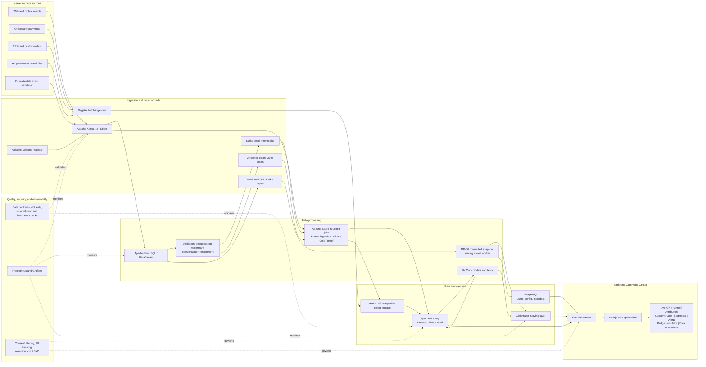
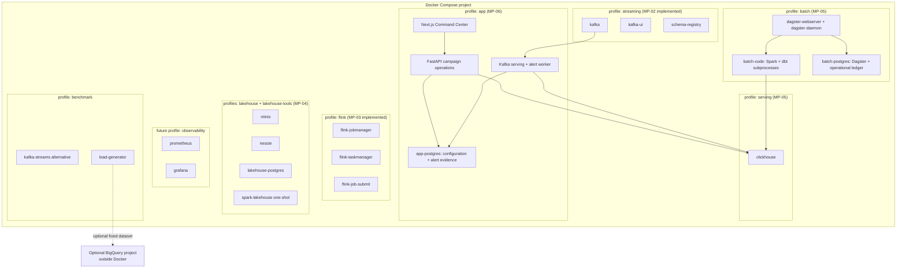

# MarketPulse 360 - High-Level Design

## 1. Architecture decision

MarketPulse 360 is an end-to-end marketing data product composed of:

1. A streaming and batch data engineering platform.
2. A lakehouse that preserves raw and curated historical data.
3. A low-latency analytical serving layer.
4. A Marketing Command Center that proves the processed data is useful.

The recommended core deployment is fully reproducible with Docker Compose:

- Apache Kafka in KRaft mode as the event backbone.
- Apache Flink for stateful stream processing.
- Apache Spark for bounded Bronze ingestion and snapshot-pinned Silver/Gold builds.
- MinIO and Apache Iceberg for the lakehouse.
- ClickHouse for low-latency analytical queries.
- PostgreSQL for application and platform metadata, not as the main analytical warehouse.
- Dagster and dbt Core for scheduled ingestion, orchestration, tests, and batch models.
- FastAPI and Next.js for the application.
- Prometheus and Grafana for platform observability.

BigQuery is an optional cloud benchmark target, not a required runtime dependency.

### Mapping to the course technology categories

The technologies in the project requirements are examples rather than a closed
list (the source document ends both lists with an ellipsis). The report must still
state explicitly which technologies belong to each category:

| Course category | Selected solution | Role in MarketPulse 360 |
|---|---|---|
| Data management | Apache Iceberg + MinIO | Durable lakehouse tables and Bronze/Silver/Gold history |
| Data management | ClickHouse | Columnar analytical serving database for the application |
| Data management | PostgreSQL | Transactional application and platform metadata only |
| Data management alternative | BigQuery/BigLake | Managed cloud warehouse/lakehouse benchmark |
| Data processing | Apache Flink | Main stateful stream-processing engine |
| Data processing | Apache Spark | Bounded lakehouse ingestion, snapshot builds, verification, and reproducible backfills |
| Data processing alternative | Kafka Streams | Controlled alternative for Kafka-native processing |
| Messaging/ingestion infrastructure | Apache Kafka | Durable event transport; Kafka itself is not Kafka Streams |
| Batch transformation/orchestration | dbt Core + Dagster | SQL business models, tests, scheduling, and backfills |

Apache Kafka and Kafka Streams must not be presented as the same component.
Kafka is the distributed event log used by the system. Kafka Streams is a Java
stream-processing library that consumes and produces Kafka topics. In the primary
solution, Kafka transports events and Flink processes them. Kafka Streams is used
only in the alternative benchmark.

## 2. System context

The reference business is an omnichannel retailer running campaigns on Google Ads,
Meta, TikTok, email, web, and mobile applications. Marketing data is currently
fragmented across ad platforms, CRM, clickstream, and order systems. MarketPulse
360 unifies these sources and supports near-real-time campaign decisions.

Primary users:

- CMO and Marketing Director.
- Performance Marketing Manager.
- CRM and Lifecycle Marketer.
- Marketing/Data Analyst.
- E-commerce or Product Manager.
- Data Engineer and Platform Administrator.
- Data Owner or Privacy Officer.

## 3. High-level architecture



## 4. Main data flows

### 4.0 Source simulation boundary

Before real integrations are available, the `marketpulse_mock` package produces
deterministic, correlated representations of Google Ads, Meta Ads, TikTok Ads,
web/mobile analytics, CRM, commerce, and email systems. Ad platforms expose daily
aggregate reports, while first-party clickstream and order systems expose event-level
records connected by platform click IDs, campaign IDs, sessions, customers, and
orders. This deliberately mirrors common marketing integration boundaries instead
of pretending that advertising platforms provide unrestricted user-level impression
logs.

Small fixtures are versioned for correctness tests. Large `demo` and `benchmark`
runs are generated locally under ignored `data/generated/`, accompanied by a
manifest with seeds, schemas, counts, anomalies, checksums, and expected aggregates.
MP-02 replays event-level files to Kafka with configurable event-time speed, fixed
events-per-second pacing, or an explicit no-sleep mode. Batch-shaped vendor reports
and CRM snapshots remain inputs to the later Dagster path.

The generator writes each source incrementally. A bounded priority queue merges only
the currently overlapping journeys so every replayable partition remains ordered by
event time without sorting or retaining a whole day in memory.

Purchases use the latest eligible paid click, including a newer click that occurs
while journeys overlap. Email unsubscribe events deterministically update later CRM
snapshots and suppress future sends. The validator checks source-specific envelopes,
UTC partitions, schemas, file hashes, anomalies, cross-source attribution, ad spend,
orders, refunds, and daily ground truth. Its reconciliation state is finalized and
released at each date boundary so memory does not grow across the complete run.

Mock source data is not application operational data. User accounts, saved segments,
alert rules, annotations, and platform configuration created through the future
MarketPulse 360 application remain a separate PostgreSQL domain.

### 4.0.1 Implemented evidence (MP-01)

As of 2026-10-11, the source-simulation boundary is implemented and verified:

| Evidence | Result |
|---|---:|
| Automated tests | 69 passing |
| Committed seed-360 fixture | 615 rows, 22 files, 116 KB |
| Local seed-360 demo | 1,200,225 rows, 130 files, about 90 MB compressed |
| Demo time range | 2026-01-01 through 2026-01-14 UTC |
| Demo master data | 50,000 customers, 30 campaigns, 1,000 products |
| Demo injected anomalies | 6,688 late, 2,237 duplicate, 619 bot, 310 invalid, 917 refund events |

The fixture is tracked for repeatable tests. The demo is regenerated from its seed
and remains outside Git. Both use the same CLI, schemas, writer, manifest, and
validator; therefore the fixture is not a simplified parallel implementation.

### 4.1 Streaming path

1. Web, mobile, order, and simulator events are published to Kafka.
2. Kafka records are validated against versioned JSON Schema contracts registered
   in Apicurio Registry. Canonical JSON keeps MP-01 fixture bytes directly
   inspectable during the classroom demo; Avro remains a future optimization when
   binary size becomes more important than transparency.
3. Flink applies event-time processing, watermarks, deduplication, sessionization,
   identity enrichment, and campaign aggregation.
4. Invalid records are written to dead-letter topics with an error reason.
5. Valid records are written to versioned clean Kafka topics. MP-04 archives bounded
   raw plus clean/DLQ offsets into Iceberg Bronze and builds governed Silver tables
   from the proved MP-03 clean contract.
6. Low-latency campaign aggregates are later upserted to ClickHouse using stable event
   and aggregate keys so retries do not inflate KPIs.
7. The application reads live KPI and drill-down data from ClickHouse.

### 4.2 Batch path

1. Dagster retrieves campaign spend, CRM snapshots, and historical files.
2. Exact compressed source files are copied to a content-addressed Bronze archive
   on MinIO before their rows are parsed into Iceberg.
3. MP-04 Spark jobs build deterministic Silver and Gold tables; MP-05 runs them
   through Dagster and uses dbt to build/test the serving copies without changing
   lakehouse contracts.
4. Gold aggregates required by interactive pages are published to ClickHouse.
5. Backfills and reprocessing use recorded historical Iceberg snapshots rather than the
   application database.

### 4.3 MP-04 lakehouse boundary

MP-04 uses Spark `4.0.4`, Iceberg `1.12.0`, MinIO, and Nessie `0.109.0` with a
dedicated PostgreSQL `JDBC2` version store. PostgreSQL contains catalog metadata
only; table data and Iceberg metadata files live in MinIO. Spark uses native
`NessieCatalog` plus `S3FileIO`.

Bronze has three immutable contracts: exact Kafka records, archived compressed
source files, and parsed file rows. Kafka archival covers the three MP-02 raw topics
plus MP-03 clean customer events and processing DLQ. Each bounded ingest uses a
versioned topic-partition `[start,end)` manifest, preserves exact bytes and lineage,
and rejects Kafka position/content collisions. CRM, three platform ad reports, and
master data are archived by content hash before parsing; ground truth and replayable
event files are not business inputs.

Kafka Bronze rows also retain `ingestion_manifest_sha256`, the canonical offset
manifest digest for the first insertion. Evidence binds that digest and the actual
topic/partition bounds to the recorded Kafka snapshot, and binds file counts,
content hashes, and manifest hashes to all three recorded Bronze snapshots. Offset
gaps from transaction markers/aborted values remain explicit `read_committed`
ingestion evidence. The smoke waits for source processing and a later completed
Flink checkpoint, then counts committed messages rather than Kafka positions.

Silver consumes the MP-03 clean contract, re-deduplicates deterministically, applies
session identity stitching, consent, late eligibility, and whole-session bot rules,
and joins typed customer/campaign/ad-spend dimensions.
The MP-03 clean v1 envelope omits the original top-level `click_id`. Silver
recovers it by joining the clean record's exact raw topic/partition/offset lineage
to the same Bronze snapshot, verifies event identity, and reads the raw envelope
field. This preserves real paid touches without changing the MP-03 contract.
Payload-conflict detection compares the clean logical hash together with this
recovered click ID using a null-safe struct; different paid-touch identities are
reported as conflicts even when the clean v1 envelopes are otherwise identical.
Gold exposes funnel, first/last/linear attribution, Customer 360, cohort retention, and campaign
performance tables. Evidence records both MP-03 source totals and consent-governed
Gold totals, because those layers intentionally answer different questions.
Gross revenue counts only `order_created`; refund amounts count only
`order_refunded`. Refund payloads retain the original order gross as context, so
that value must not be counted as a second sale in evidence, customer profiles,
campaign performance, or attribution.

Every build records input/output snapshot IDs, fingerprints of the physical Iceberg
name/type/nullability schemas, complete canonical-row checksums, quality counts, and
financial reconciliations. Evidence embeds the exact offset/file manifests with
their SHA-256 values. Verification reads the documented baseline through Iceberg
`VERSION AS OF`, walks snapshot `parent_id` links to prove the baseline is an
ancestor of the recorded current head, and recomputes every rowset, quality block,
and revenue block. The backfill proof reads the exact Bronze snapshot IDs and writes
to a new `rebuild_<run_id>_<identity>` namespace; it refuses existing or original
namespaces and asserts that original table heads do not change.

MP-04 implementation progress:

| Slice | Status |
|---|---|
| Ordered Iceberg contracts | Implemented: 13 Bronze/Silver/Gold table contracts with keys, types, partitions, and business-checksum columns |
| Deterministic primitives | Implemented: Kafka/file ingest IDs, namespaced profile identity, lossless integer attribution allocation, schema fingerprints, canonical rowset checksums, and table-evidence comparison |
| Local storage/catalog stack | Implemented: Compose profiles provide PostgreSQL 17.6 (`lakehouse_catalog`), checksum-verified MinIO `RELEASE.2025-04-22T22-12-26Z` (`lakehouse_data`), one-shot `mc`, Nessie 0.109.0, and an on-demand non-root Python 3.12/Spark 4.0.4/Iceberg 1.12.0 tool with a portable `lakehouse_evidence` volume; the API/console/catalog ports are 9000/9001/19120 |
| Immutable Bronze ingestion | Implemented: CLI bootstrap, complete `read_committed` Kafka offset manifests, exact Kafka byte/header archival, cryptographically verified content-addressed source-file archival, insert-only Iceberg merges, collision checks, and offset-gap evidence |
| Governed Silver build | Implemented: explicit Bronze snapshot reads, complete clean/DLQ validation, bidirectional raw-outcome reconciliation, windowed total-order deduplication, conflict evidence, session identity stitching, consent/late/bot exclusions, distributed latest-CRM and campaign/ad joins, and source-specific spend conversion |
| Marketing Gold models | Implemented: snapshot-pinned Spark builds publish distinct-session funnels, deterministic first/last/linear attribution, customer 360, cohort retention, and full-outer campaign performance |
| Evidence and rebuild proof | Implemented: schema v1 manifests record baseline/later snapshot pairs, embedded input provenance, physical schema fingerprints, full canonical business-row checksums, recomputed quality/revenue reconciliation, parent-chain historical verification, and collision-safe isolated rebuild comparison |

The storage persistence smoke test writes an Iceberg row, restarts MinIO, Nessie,
and their PostgreSQL version store, and reads the same row and snapshot metadata
back successfully. The isolated Bronze integration proof created all 13 tables,
archived the fixture manifest plus 12 eligible compressed files, inserted 12 file
records and 380 canonical file rows, and ingested 219 Kafka records from the three
raw topics. Repeating both bounded inputs inserted zero records: the same file run
reported 13 existing archive objects, 12/380 no-op table rows, and unchanged
snapshot IDs; the same Kafka manifest reported 219 no-ops and no offset gaps.
A transactional Kafka probe added one committed and one aborted clean record. Bronze
observed only the committed value, reported the aborted offset as one explicit gap,
rejected a conflicting same-batch immutable key without changing the 220-row table,
and inserted zero rows when the same manifest was retried. MP-04 has focused
contract, ingestion, governance, Gold, evidence, and Docker-asset tests. The exact
suite count is reported by fresh verification rather than treated as an architecture
invariant.

The Silver fixture oracle resolves 100 latest customer profiles, six campaigns,
12 daily platform-spend rows, 1,000 impressions, 73 clicks, `551,737` VND minor
units of spend, and `29,718,000` conversion-value minor units. A real snapshot-
bounded Spark build materialized all five Silver Iceberg tables through distributed
transforms and atomic `INSERT OVERWRITE`; a one-event integration probe produced
one governed event and one quality row alongside the complete fixture dimensions.
The same integration produced all five Gold tables twice, retained the earlier
Iceberg snapshots for time-travel reads, generated evidence for all ten Silver/Gold
tables, verified physical schemas and every recorded historical checksum, and
rebuilt the same ten business rowsets in a collision-resistant isolated namespace
without changing the original snapshot heads. Linear attribution uses integral
Spark `DIV` plus deterministic remainder assignment, including amounts beyond
floating-point precision; `__unattributed__` is reserved at the Silver boundary.

The full MP-04 fixture proof on 2026-10-13 archived 439 raw Kafka records and 217
clean records (zero processing-DLQ records), accepted 191 governed events, excluded
12 bot and 14 consent-denied events, and accounted for 222 duplicates. It verified
and rebuilt all ten Silver/Gold rowsets after later output snapshots and a
catalog/storage restart. All 13 archived source objects were retrieved with exact
size/hash/bytes, and broker samples independently matched Bronze keys, values,
ordered duplicate/null/binary headers, timestamps, and offset provenance.
Source gross/refund/net totals were `29,718,000 / 4,967,000 / 24,751,000` minor units;
governed totals were `27,160,000 / 4,967,000 / 22,193,000`. First-touch, last-touch,
and linear attribution each reconciled to the governed totals and contained paid
attribution. The anonymous Customer 360 profiles retained three orders and
`4,046,000` gross minor units. A real Spark regression additionally verifies a
deterministic winner plus conflict evidence for identical clean payloads whose
raw ancestors differ only in click ID, including null versus a paid click.
This is a correctness/reproducibility proof, not a capacity benchmark. Operator
commands and evidence locations are documented in
[`lakehouse-local.md`](../runbooks/lakehouse-local.md).

### 4.4 MP-05 batch/serving boundary (implemented, local proof verified)

The scope in `specs/05-batch-orchestration-and-serving.md` adds scheduled Dagster
assets for ad reports, CRM, historical/master files and bounded Kafka ingestion.
MP-04 Spark transformations continue to build snapshot-pinned Silver/Gold; dbt
Core with dbt-clickhouse builds and tests serving relations from exported snapshot
copies. The local correctness, query and recovery proof is verified; GitGuardian
Security Checks passed on PR #5. There is no separate GitHub Actions CI workflow
configured; regression/integration evidence is from the observed local runs.

Implemented first: optional daily file-ingest selection preserves the MP-04
all-file default. It requires nonempty configured report platforms and CRM;
checks Google `segments_date`, Meta `date_start`/`date_stop`, TikTok `stat_time_day`
and CRM `snapshot_date` against the UTC file partition; retains shared master
files and original row lineage. Preparation identities hash selected day/platforms,
model digest and pinned Bronze snapshots. Local receipt files use exclusive atomic
creation, immutable snapshot maps and conflict detection; PostgreSQL/Dagster
integration of the receipt contracts is implemented: the separate batch
PostgreSQL `marketpulse_ops` schema stores immutable preparation receipts,
attempt counters and frozen publication reservations. Reservations use a
transactional advisory lock and unique identity; older logical days and payload
changes are rejected. Publication acknowledgement is idempotent. The append-only
ClickHouse journal resolves the greatest published generation, collapses identical
deliveries and rejects conflicting generation/identity payloads. Publication
re-verifies persisted certification artifacts and current served rowsets first.

Implemented export/copy: Spark reads exact receipt snapshots, verifies source
schemas and emits bounded JSON partition files on worker scratch. Files are
conditionally uploaded into owned MinIO `batch-exports/<identity>/<attempt>`
prefixes; manifests bind source IDs, typed columns, bytes/hashes/counts and full
business rowset checksums. Disk-backed sorted row hashes preserve duplicates
without collecting the whole dataset in Python. Fresh Atomic ClickHouse
candidate databases receive typed MergeTree raw copies in bounded chunks;
partial attempts are never reused. Exact integers/decimals/nulls/UTC timestamps
survive transfer. The seven-table real Spark/MinIO/ClickHouse roundtrip and
pinned-snapshot-after-head-change proof passed. dbt now builds five exact Gold
tables, two reference dimensions and `campaign_dashboard`; its 28 tests cover
required fields/keys/domains/relationships, consent, cohort/funnel invariants and
financial conservation. Certification verifies the successful complete dbt
invocation, every typed served rowset and independent Decimal CTR/CPC/dimension
oracles, then writes an immutable proof digest. Actual eight-model/28-test build
passed; changed monetary rows with unchanged counts and injected missing campaign
references were rejected. A real queued Dagster refresh completed ingestion,
pinned Bronze, owned Silver/Gold, export, copy, dbt, certification and generation-1
publication. A receipt-only historical job rebuilt and certified in isolation,
without publication; native backfill tags also block promotion. Six independent
query oracles and 20-warmup/100-sample uncached benchmarks passed, including after
a restart of ClickHouse, PostgreSQL and the three Dagster services. Test-owned
lost-acknowledgement recovery leaves the reservation unacknowledged, ends the
publisher process, restarts services, then repairs it in a new process while
preserving one logical publication; active identity,
snapshots, row counts and exact money remain equal before/after restart.

ClickHouse receives isolated candidate release databases. All five Gold rowsets
must pass schema/key/checksum/financial reconciliation and dbt tests before a
certified generation can enter an append-only publication journal. PostgreSQL
reserves immutable generation payloads; readers select the greatest published
generation, so a delayed older publisher cannot roll back a newer release.
The operational ledger also freezes certified bundle URIs/database/digest by
preparation identity. A new refresh of identical inputs reuses the certified
export, database and dbt invocation, re-verifies their contents, and acknowledges
the same generation. It never rebuilds a sealed serving database or attempts to
replace its reservation. Reused dbt outputs follow the actual asset DAG order.
All daily asset stages explicitly use one partition per backfill run. Partial
re-execution resolves dbt candidate handoffs through the current run and its
exact recorded parent ancestry. Certification/publication pin the same candidate
even when partition IO has a later materialization; dbt results stay beside that
candidate. Publication gets the receipt by certified identity from the ledger.
Run metadata/artifact retention is part
of recovery. Source-history job backfills perform first-time ingestion, while
normal asset backfills remain receipt-only.
Actual two-day native job/asset backfills completed successfully, and GraphQL
re-executions from dbt failure, certification and publication all succeeded after
those backfills without changing the active generation.
Reader requests pin a single certified
database; retries do not append duplicate rows into an active dataset. Historical
rebuilds do not promote by default. Iceberg/MinIO remains the durable truth.

The CLI exposes six parameterized query workloads; values are bound and relation
names are allowlisted. Dates use UTC `[from,to)`. Campaign financial queries group
by currency. Attribution/customer Gold schemas do not encode currency, so their
queries reject mixed-currency releases. Customer drill money is explicitly
snapshot-lifetime, filtered by last activity; cohort filtering uses activity month.
Funnel rows remain per campaign to avoid incorrectly summing unique sessions.
Verification binds the resolved journal release to its PostgreSQL bundle,
certification and immutable export, and computes independent Python query answers
from validated export objects. The recovery script operates on an explicitly
selected test-owned project; bootstrap/replay is documented separately.

The implemented `batch` and `serving` Compose profiles contain authenticated
ClickHouse, Dagster webserver/daemon/code location, and separate PostgreSQL
operational metadata. Jobs run in the code-location container without mounting a
host Docker socket. All credentials remain in ignored `.env`. App/API/UI behavior
and continuous Flink-to-ClickHouse updates are outside MP-05. An explicit build
script builds the local Spark base before the batch image. Missing MP-05 secrets
fail service startup without breaking disabled-profile MP-04 workflows. The
code location exposes the marketing asset graph and three jobs. An isolated
proof runs Dagster on localhost:43000 and ClickHouse on localhost:48123; runtime
health, ledger tests, queued refresh, historical rebuild and local
latency/restart/recovery checks passed. The fixture has 239 rows across seven
copied relations and 22 source files/615 rows; measured fixture timings do not
establish large-scale capacity. Dagster explicitly uses
psycopg2 for notification compatibility with SQLAlchemy 2.1; the operational
ledger uses psycopg3. The tracked instance config is mounted read-only over the
persistent instance volume. See `docs/runbooks/batch-serving.md`.

### 4.5 MP-06 campaign operations boundary (implemented; local proof verified)

The user delegated MP-06 scope to the ordered backlog. Strict dependency-free
application contracts and exact Decimal pacing/scenario/alert primitives are
implemented and unit-tested. FastAPI/Next.js and app persistence run in Docker;
final review regressions and refreshed acceptance passed.
Its binding specification
is [06-live-campaign-and-budget-operations.md](../../specs/06-live-campaign-and-budget-operations.md)
and its [implementation plan](../superpowers/plans/2026-10-13-campaign-budget-operations.md)
executes in the existing source tree, based on merged MP-05 PR #5.

FastAPI now exposes request-pinned dashboard, settings/rules, alert evaluation,
pacing and read-only simulation routes; its contract tests cover exact money,
parameterized queries, configured-market filtering, stale writes and missing releases.
Next.js implements the Marketing Command Center with live KPI monitoring, explainable campaign alerts,
budget pacing and what-if allocation. Certified campaign finance remains in the
MP-05 immutable ClickHouse releases. A validated serving adapter synchronously appends
MP-03 campaign snapshots into a separate `marketpulse_live` projection, selecting
whole latest keyed snapshots by Kafka offset and collapsing retries. Real ClickHouse
integration verifies duplicate/out-of-order delivery, null currency, conflicting
positions and changed source identity rejection. A manual-commit read_committed
worker and periodic evaluator run in healthy Docker services. Provisional
streaming counts/money are displayed separately from consent/bot-governed Gold.
No metric adds both sources or mixes live revenue with daily batch spend.

A dedicated application PostgreSQL database/schema stores user-created campaign
market/budget settings, versioned alert rules and immutable evaluation evidence.
Their additive migrations and concurrency/idempotency tests run against a
dedicated `mp06_test` PostgreSQL database. The evaluator uses the global latest
closed release date, requires actual calendar baselines and hashes immutable
release/rule/setting/window identities; no polling timestamp changes that key.
It contains no generated source customers, analytical warehouse copy or seeded
application accounts. Existing Gold has no market dimension: the UI filter means
configured campaign market, with unassigned values explicitly unknown.
Daily spend supports closed-day pacing only; gaps/zero baselines produce explicit
insufficient-data states. Simulations are read-only linear historical-ROAS
scenarios. Every metric records its model/source and actual data timestamp;
historical replay, API polling and retry delivery cannot masquerade as fresh
business events. New app services use the Compose `app` profile and separate
persistent app metadata. FastAPI 0.143.0/Uvicorn 0.54.0/Pydantic 2.14.1 use a
hashed Python lock; Next.js 16.4.0/React 19.3.0 use an npm lock and Node 24.21.0.
Nonroot API/worker/web images have built successfully; TypeScript/production build
and browser behavior tests cover discarding an old pending scenario
after its interval changes. All four app services are healthy in the existing
MP-05 proof project; actual desktop/mobile UI inspection shows 14 separate live
keys and unchanged certified totals. The first independent Docker proof passed
keyed Kafka equality, lost-offset-acknowledgement retry, persistent app restart
and all three fixture HTTP budgets; the final images passed this proof again.
Final review found budget-day identity,
Decimal comparison and UI ordering issues; focused RED/GREEN regressions address
them, followed by nine green browser tests, 333-test Python regression suite
(27 opt-in skips, three new integrations separately exercised), production builds
and fresh Docker acceptance. Budget alerts use actual closed-day intervals
and trigger known overruns during an active period. Streaming source identity/
offset bounds and full alert versions are inspectable in the app.
MP-01–05 contracts and pipelines remain intact. The fixture has 615 rows in 22
source files; 217 Kafka snapshots resolve to 14 live keys. Final fixture HTTP p95
(20 warmups/100 uncached requests) is 26.41 ms dashboard, 16.92 ms pacing, 20.32 ms
simulation. A test-owned adapter-to-analytical-response measurement was 58.44 ms;
it excludes HTTP and is separate from historical business event age. No capacity
or event-to-dashboard SLA is implied. See the [runbook](../runbooks/campaign-operations.md)
and [decisions](mp06-decisions.md).

### 4.6 MP-07 analysis boundary (implemented and locally verified)

MP-07 implements a tested request-pinned analytical read service for
channel/campaign stage reach and exact three-model/global reconciliation.
Read-only HTTP, bounded journeys and a race-safe `/analysis` workspace are implemented and exercised on Docker; independent export/Silver/HTTP and restart proof has passed. Fresh whole-branch review found no blocking issues. It extends the FastAPI/Next.js application with channel/campaign stage reach,
first/last/linear attribution comparison and representative order journeys.
Its [spec](../../specs/07-funnel-and-attribution-analysis.md) and
[plan](../superpowers/plans/2026-10-13-funnel-attribution-analysis.md) preserve
MP-04 Gold semantics and MP-05 certification. Aggregates read existing immutable
ClickHouse funnel/attribution tables with one release per request. Cross-bucket
session sums are labeled campaign-day incidences, not global unique audiences.
Attribution global reconciliation precedes dimension filters and requires a
single-currency release, matching the existing currency-less Gold contract.

An explicit `app-tools` Spark publisher now reads that release's recorded Silver
snapshot, sanitize profile identity and copy exact event detail into a separately
validated immutable ClickHouse sidecar. It does not change the seven-relation
MP-05 export or promote a new release. APIs query only ClickHouse; PostgreSQL
holds config/coordination, not analytical events. Representative explanations
reuse the existing Gold helper on bounded canonical touch/financial context.
Click deduplication covers the full pinned snapshot before the order window.
The real publisher copied and verified 191 governed rows from Silver snapshot
`505365576434850409`, with typed full-row checksum equality. Earlier failed
attempts remained isolated. Global paid-click canonicalization is a ClickHouse
view over the complete projection. Commerce events retain the bot-session flag
per MP-04 policy; web/mobile bot activity and consent-denied rows are rejected.
Partial/missing/conflicting sidecars never appear as complete journey data.
No source generation/replay or earlier pipeline reimplementation is required.

Independent pinned exports and sidecar-recomputed Gold establish full-row equality;
all three models reconcile gross/refund/net. On the 191-event fixture, p95 HTTP
latency was 26.58/18.96/77.84 ms for funnel/attribution/five journeys, each with
20 warmups/100 uncached samples and zero failures. API/web restart preserved MP-06
operational state and MP-07 outputs. Desktop/mobile/drill visual checks and all
fourteen browser tests passed. See [decisions/evidence](mp07-decisions.md) and
[runbook](../runbooks/funnel-attribution.md) for bounds and explicit publication.

### 4.7 MP-08 Customer 360 and lifecycle boundary (specified; implementation pending)

The [MP-08 spec](../../specs/08-customer-lifecycle-intelligence.md) extends the
existing FastAPI/Next.js app with historical cohorts, pseudonymous RFM profiles,
governed timelines and versioned segment previews. Analytical queries reuse the
immutable ClickHouse Customer 360/cohort/CRM relations and MP-07 event sidecar;
no earlier pipeline/export contract or new Spark publication is needed.
PostgreSQL stores only operator-authored segment definitions and immutable revisions.
Release-scoped hashes connect profile drills to governed event detail. Identity
confidence is categorical evidence of existing deterministic rules, not a new
probabilistic merge. Historical governed cohorts remain distinct from activation:
activation requires an identified CRM customer with both current-in-release
analytics and marketing consent; unknown/denied consent fails closed. Analytics
CRM denial suppresses timeline detail. RFM/as_of is pinned to data, not wall time;
heuristics are explained and exact finance remains single-currency guarded.

## 5. Kafka design

Suggested topic naming:

```text
marketing.raw.web-events.v1
marketing.raw.order-events.v1
marketing.raw.email-events.v1
marketing.raw.ad-spend.v1
marketing.raw.crm-changes.v1
marketing.clean.customer-events.v1
marketing.clean.campaign-events.v1
marketing.gold.campaign-metrics.v1
marketing.gold.customer-profile.v1
marketing.dlq.validation.v1
```

Kafka deployment decisions:

- Pin the local MP-02 stack to Apache Kafka `4.3.1`, Apicurio Registry `3.3.3`,
  and Kafbat UI `1.5.0`; ZooKeeper is not required.
- Start with one broker for the laptop demo and use three brokers only for a
  failure-tolerance experiment or larger VM deployment.
- Use replication factor 1 locally and document that production would use 3.
- Partition high-volume topics by `customer_id` or `session_id`; partition
  campaign aggregates by `campaign_id`.
- Use deterministic `event_id` values and idempotent producers.
- Retain MP-02 topics for seven days (`retention.ms=604800000`) and reject existing
  topics whose partition count or retention configuration has drifted. Iceberg
  remains the durable long-term history.
- Partition raw web, order, and email topics into six partitions. Keys prefer
  `customer_id`, then fall back to source-specific session/order/message identity,
  preserving per-identity order.
- Route deterministic MP-01 quality cases to `marketing.dlq.validation.v1` with
  their expected reason code; CRM and ad reports stay on the later batch path.

### 5.1 Implemented evidence (MP-02)

As of 2026-10-11, the Kafka ingestion boundary is implemented and verified with
118 passing automated tests plus a clean real-container smoke run. The pinned
stack is Kafka `4.3.1`, Apicurio Registry `3.3.3`, and Kafbat UI `1.5.0`.

| Fixture delivery evidence | Acknowledged and consumed |
|---|---:|
| `marketing.raw.web-events.v1` | 199 |
| `marketing.raw.order-events.v1` | 14 |
| `marketing.raw.email-events.v1` | 6 |
| `marketing.dlq.validation.v1` | 4 |
| Total | 223 |

The verification run registered the four JSON Schema contracts twice to prove
idempotence and delivered 223 records in 0.595 seconds (374.5 records/second) in
no-sleep mode. It compared exact consumed event IDs and DLQ reason codes, not only
counts. Replay shutdown interrupts pacing/backpressure waits, always flushes accepted
records, and excludes paused time from throughput. This small fixture measurement
proves the control path and exact accounting; MP-10 will perform capacity benchmarks
on named larger profiles.

### 5.2 MP-03 Flink processing boundary

MP-03 is designed as a Java 17 DataStream job on Apache Flink `2.2.1` with
Kafka connector `5.0.0-2.2`. It consumes the three raw event topics, assigns
timestamps and bounded watermarks at the Kafka source so each partition/split owns
its event-time progress, validates version-1 envelopes, deduplicates by `event_id`,
classifies late events, creates 30-minute web sessions, and maintains campaign/day
funnel and revenue state. Invalid or tombstone values cannot advance a watermark
and are routed to the processing DLQ with their Kafka lineage intact.

The milestone deliberately writes its clean and aggregate products back to
versioned Kafka topics. This keeps recovery testing independent of storage work;
MP-04 attaches MinIO and Iceberg sinks to the same clean contracts.

```text
marketing.clean.customer-events.v1
marketing.clean.sessions.v1
marketing.gold.funnel-metrics.v1
marketing.gold.revenue-metrics.v1
marketing.gold.campaign-metrics.v1
marketing.dlq.flink-validation.v1
```

Clean events and the processing DLQ retain seven days. Sessions use compact-plus-
delete for seven days; Gold topics use compact-plus-delete with thirty-day retention
so the latest keyed snapshot is directly consumable. Kafka assigns output record
timestamps at publish time, while business `event_time` remains in each JSON value;
this prevents historical replays from being deleted immediately by topic retention.
Flink
checkpoints source offsets, keyed state, timers, and transactional Kafka output to
a named local volume. The recovery demonstration restarts the TaskManager after a
completed checkpoint while the replay producer remains active, verifies raw input
progress on both sides of the restart, and reconciles exact final IDs, per-campaign
KPIs, session contracts, late-event probes, DLQ lineage, all six output schemas,
and the job's accepted/duplicate/late/invalid counters via the Flink REST API.

Implemented MP-03 slices:

| Slice | Status |
|---|---|
| Design, public output contracts, and recovery oracle | Implemented and fixture-derived |
| Kafka topic/schema assets | Implemented: 10 versioned contracts with contract-driven retention and cleanup validation |
| Flink raw-byte parser and validation DLQ | Implemented: Java 17 boundary preserves Kafka lineage, safely rejects null/tombstone values, validates all three source envelopes, and covers 10 deterministic failure reasons |
| Flink stateful transformations | Implemented: checkpoint-restored 7-day deduplication, late/correction classification, 30-minute session upserts, and unified campaign/funnel/revenue state; 12 operator-harness tests |
| Executable Flink job | Implemented: three-topic Kafka source with partition-aware event time, validation side output, state branches, invalid-record metrics, and one exactly-once dynamic Kafka sink in a 23 MB shaded JAR; 30 Java tests |
| Dockerized Flink cluster | Implemented: pinned Java 17 multi-stage image, healthy JobManager/TaskManager, two slots, retained checkpoint volume, named-job submission guarded across all non-terminal job states, and dashboard on port 8082 |
| Mid-replay recovery evidence | Implemented: an active producer crossed a TaskManager restart, raw input advanced from 83 to 219, checkpointed state restored, and all six `read_committed` outputs reconciled |

The local deployment was exercised against Kafka `4.3.1`: job
`marketpulse-stream-v1` reached `RUNNING` with all 10 execution tasks running,
one registered TaskManager and two occupied slots. Re-running the submitter returned
success without creating a duplicate job. The Kafka producer transaction timeout is
explicitly ten minutes so it stays below the local broker maximum while comfortably
exceeding the five-second checkpoint interval.

The isolated recovery proof retained 217 unique fixture event IDs, rejected two
duplicate copies, produced 73 latest session keys, routed one malformed record to
the processing DLQ, and preserved one watermark-late audit event without mutating
aggregates. It restored checkpoint `18`, completed checkpoint `19`, and recovered in
16 seconds while raw inputs advanced from 83 to 219 records on the verification
machine. Gross revenue `29,718,000`, refunds
`4,967,000`, and net revenue `24,751,000` minor units matched the fixture oracle.

## 6. Storage decision: BigQuery versus PostgreSQL

BigQuery and PostgreSQL do not solve the same problem and should not be treated
as interchangeable databases.

| Concern | PostgreSQL | BigQuery | Project decision |
|---|---|---|---|
| Docker/local execution | Excellent | Not self-hostable | PostgreSQL for the local stack |
| Transactions and application state | Excellent | Not its primary role | PostgreSQL |
| Large analytical scans | Limited compared with a columnar warehouse | Excellent | Iceberg/ClickHouse locally; BigQuery optionally |
| Real-time dashboard serving | Good for small data | Possible, but adds cloud/network dependency | ClickHouse |
| Operations | Team manages container | Fully managed by Google Cloud | Local reproducibility wins for the core demo |
| Cost model | Fixed local resources | Storage plus bytes scanned or reserved capacity | Avoid mandatory cloud cost |
| Academic comparison | Useful OLTP baseline | Strong cloud warehouse alternative | Use both only in benchmark profiles |

### Final recommendation

Do not use PostgreSQL as the only database. It would make the project look like a
normal web application with ETL and would weaken the Big Data and technology
evaluation story.

Do not make BigQuery mandatory. It is a managed Google Cloud service, cannot be
started by Docker Compose, requires authentication, and can introduce network,
quota, billing, and classroom-demo risk.

Use this split instead:

- PostgreSQL: users, roles, saved segments, campaign configuration, alert rules,
  Dagster metadata, and optional Iceberg catalog metadata.
- Iceberg on MinIO: durable Bronze, Silver, and Gold history.
- ClickHouse: interactive and near-real-time application queries.
- BigQuery: optional cloud alternative for a controlled warehouse benchmark.

If the group has Google Cloud credits, export a fixed Gold dataset to BigQuery and
compare the same analytical queries across BigQuery, ClickHouse, and PostgreSQL.
This adds an excellent alternative-solution section without making the live demo
dependent on the cloud.

## 7. Docker deployment view

The first implemented slice is the `streaming` profile: one Kafka 4.3.1 KRaft
broker, idempotent four-topic initialization, Apicurio Registry 3.3.3, and Kafbat
UI 1.5.0. A separate `replay` tool container reads the committed MP-01 fixture or
locally generated data through a read-only mount. It is activated only when the
operator invokes it, so starting the streaming profile never publishes data by
surprise. Kafka is reachable as `localhost:9092` from the host and `kafka:29092`
inside Compose; the UI and Registry API are exposed on ports 8080 and 8081.
The implemented `flink` profile adds a Java 17 JobManager, TaskManager, idempotent
one-shot submitter, retained checkpoint volume, and Web UI on port 8082.



Recommended laptop profiles:

```bash
docker compose --profile streaming --profile flink up -d --build --wait
```

MP-05 adds `batch` and `serving`; MP-06 adds `app`; MP-09 adds `observability`. Run the
Kafka Streams alternative separately when memory is limited.

Credential configuration is local-only: the committed `.env.example` contains
empty password fields, while ignored `.env` supplies separate PostgreSQL and MinIO
passwords. Compose requires both values with no fallback, even when resolving
streaming-only profiles. Spark and source archival reject missing/blank MinIO
passwords rather than silently using a shared default. `.env` is excluded from
Docker build contexts and credentials are not evidence fields. Existing catalog
volumes retain their initialized password; editing `.env` does not rotate it.
Local credential rotation preserves volumes: change the existing PostgreSQL role
with `psql`'s encrypted password prompt, then recreate the catalog/object services
to reload MinIO and Nessie credentials and terminate old database sessions. The
acceptance check requires new credentials to work and former credentials to fail;
health status alone is insufficient. Production secrets delivery, TLS, and
automated production rotation remain outside the local-runtime scope.
The user-authorized MP-04 history cleanup consolidates the feature changes on the
unchanged remote-main base without historical development-password commits. Local
recovery references are not pushed. Earlier clones and cached pull-request views
may still retain revoked values; rewriting a branch cannot revoke credentials.

MP-04 storage starts independently; Spark is invoked only as a tool:

```bash
docker compose --profile lakehouse up -d --wait
docker compose --profile lakehouse --profile lakehouse-tools run --rm spark-lakehouse probe-write
```

The implemented Bronze commands use the same one-shot Spark image. File ingestion
archives source bytes before parsing. Kafka capture records an immutable, canonical
manifest for all five governed topics; ingestion refuses topic/partition drift,
retention loss, a different Kafka cluster, and an existing key with different
content. Kafka isolation is explicitly `read_committed`, matching MP-03's
transactional outputs. Source objects are uploaded from a stable staged copy and
streamed back from MinIO for a body SHA-256 check before Iceberg rows can commit;
object metadata and length alone are not trusted.

```bash
docker compose --profile streaming --profile lakehouse up -d --wait kafka topic-init lakehouse-postgres minio minio-init nessie
docker compose --profile streaming --profile lakehouse --profile lakehouse-tools run --rm spark-lakehouse bootstrap
docker compose --profile streaming --profile lakehouse --profile lakehouse-tools run --rm spark-lakehouse ingest-files --run-id files-1 --input /opt/marketpulse/data/mock/fixtures/seed-360
docker compose --profile streaming --profile lakehouse --profile lakehouse-tools run --rm spark-lakehouse capture-offsets --run-id kafka-1 --output /opt/marketpulse/evidence/offsets.json
docker compose --profile streaming --profile lakehouse --profile lakehouse-tools run --rm spark-lakehouse ingest-kafka --run-id kafka-1 --offset-manifest /opt/marketpulse/evidence/offsets.json
```

MinIO's API and console are exposed on `9000` and `9001`. Nessie's API is exposed
on `19120`, while Compose checks its internal management health endpoint on port
`9000`. MinIO and `mc` are built for amd64/arm64 from pinned official release
binaries whose SHA-256 checksums are verified during the build. The reproducible
persistence proof is:

```bash
scripts/lakehouse-smoke-test.sh
```

The full MP-04 smoke proof temporarily runs the MP-03 Flink profile to produce and
reconcile clean/DLQ topics, archives bounded Kafka offsets, then stops Flink before
the one-shot Spark transforms to keep peak laptop memory bounded. Operator commands,
demo URLs, expected totals, evidence inspection, and cleanup are documented in
`docs/runbooks/lakehouse-local.md`.

## 8. Business capabilities shown by the application

The application should demonstrate at least `2 * number_of_group_members`
business requirements. Candidate capabilities are:

1. Live campaign KPI monitoring.
2. Abnormal spend or conversion alerts.
3. Cross-channel marketing funnel analysis.
4. First-touch, last-touch, and linear attribution comparison.
5. Customer 360 timelines.
6. RFM and behavioral audience segmentation.
7. Cohort and retention analysis.
8. Churn-risk or high-value-customer identification.
9. Budget pacing and over-spend prediction.
10. What-if budget allocation simulation.

Each capability must map to a source, transformation, Gold model, API endpoint,
application interaction, correctness test, and demo scenario.

## 9. Evaluation plan

### Correctness

- Reconcile source counts and revenue totals against validated Silver data.
- Inject duplicates, malformed schemas, and late events.
- Verify duplicates do not inflate Gold KPIs.
- Verify invalid events reach the dead-letter topic.
- Compare replayed batch results with streaming results on a golden dataset.

### Performance

- Measure input throughput and processed events per second.
- Measure end-to-end p50, p95, and p99 event-to-dashboard latency.
- Measure dashboard query latency on 1M, 10M, and 20M events.
- Measure recovery time after restarting a Flink TaskManager.
- Capture CPU and memory usage for Kafka, Flink, and ClickHouse.

### Application effectiveness

- Time how quickly each user role completes a defined decision task.
- Measure anomaly detection delay.
- Verify every required business requirement has a successful application demo.
- Compare the system with a daily CSV/PostgreSQL batch baseline.

## 10. Alternative solution

The primary compute solution is Kafka plus Flink. The controlled alternative is
Kafka plus Kafka Streams, while keeping the source topics, business logic, test
dataset, and analytical sink constant. This comparison evaluates a distributed
processing engine against a Kafka-native processing library without changing the
input data or application outputs.

The optional storage benchmark compares ClickHouse, PostgreSQL, and BigQuery with
the same Gold tables and query suite. This isolates technology differences and
produces defensible evidence for the final report.

## 11. External references

- Apache Kafka downloads and official Docker images: https://kafka.apache.org/community/downloads/
- Apache Kafka Streams documentation: https://kafka.apache.org/documentation/streams/
- Apache Flink documentation: https://nightlies.apache.org/flink/flink-docs-stable/
- Apache Iceberg documentation: https://iceberg.apache.org/docs/latest/
- BigQuery overview: https://docs.cloud.google.com/bigquery/docs/introduction
- BigQuery pricing: https://cloud.google.com/bigquery/pricing
- PostgreSQL partitioning: https://www.postgresql.org/docs/current/ddl-partitioning.html
