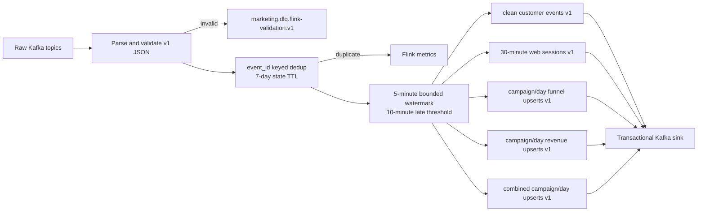

# MP-03 Stateful Flink Processing Design

## Intent

MP-03 turns the raw Kafka event log from MP-02 into trustworthy, query-ready
streaming products. It must make duplicate, invalid, and late-event behavior visible;
produce session, funnel, campaign, and revenue results; and demonstrate that Flink
recovers state from checkpoints when a TaskManager restarts.

The classroom proof is more important than production scale. A reviewer must be
able to start the local stack, replay the deterministic fixture, inspect both the
Flink UI and Kafka UI, restart a worker, and compare exact output totals with the
fixture's known truth.

## Goals

- Consume all three MP-02 raw event topics with event-time semantics.
- Validate the version-1 envelopes before business processing.
- Deduplicate globally by stable `event_id` using checkpointed keyed state.
- Classify late records consistently and expose late/duplicate/invalid counters.
- Sessionize web activity with a 30-minute event-time inactivity gap.
- Produce versioned clean-event, session, funnel, campaign, and revenue records.
- Use checkpointed Kafka offsets and transactional Kafka sinks for recovery safety.
- Run the full topology locally with Docker Compose and observable web UIs.

## Non-goals

- Iceberg/MinIO persistence belongs to MP-04.
- Dagster, dbt, ad-report, and CRM batch ingestion belong to MP-05.
- ClickHouse serving and the product UI belong to MP-05 through MP-08.
- Multi-broker Kafka, Flink high availability, TLS, and production ACLs are not
  required for the laptop demo.
- MP-03 does not reinterpret the mock generator's business truth or attribution
  rules; it processes the published version-1 contracts.

## Selected implementation

Use a Java 17 Flink DataStream job, packaged as one shaded JAR and deployed to a
Dockerized Flink session cluster. Pin Apache Flink `2.2.1` and Kafka connector
`5.0.0-2.2`. Flink 2.2.1 is a maintained bug-fix release and the 5.0.0 connector
is published for Flink 2.2; using Flink 2.3 before its matching Kafka connector is
available would weaken reproducibility.

The implementation uses explicit Java domain types instead of a large SQL script.
This keeps validation errors, state TTL, metrics, side outputs, topic routing, and
recovery behavior independently testable.

## Data flow

## Input contracts

The job subscribes to:

- `marketing.raw.web-events.v1`
- `marketing.raw.order-events.v1`
- `marketing.raw.email-events.v1`

Kafka metadata is retained with each input: source topic, partition, offset, record
timestamp, key, and headers. Validation checks supported topic/source/event-name
combinations, schema version `1`, UUID event identity, UTC event and ingestion
timestamps, identity keys, consent type, campaign requirements, and required nested
order/email payload fields. Invalid records are serialized to the MP-03-specific
processing DLQ. The MP-02 `marketing.dlq.validation.v1` contract represents
intentionally generated quality cases and remains unchanged; it cannot safely
represent malformed Kafka bytes.

## Deduplication and late data

All valid streams are unioned and keyed by `event_id`. A checkpointed `ValueState`
entry records the first accepted event; state uses a seven-day processing-time TTL,
matching Kafka's local retention. Later copies are dropped before every KPI branch,
so duplicate IDs cannot inflate clean counts or aggregates.

Watermarks allow five minutes of out-of-order event time and mark an idle source
partition after one minute. A record is classified late when either its explicit
MP-01 `is_late` marker is true or its timestamp is behind the current watermark.
Late records remain in the clean audit stream and are counted, but records more than
ten minutes behind the watermark do not update session or Gold-style aggregates.
This prevents an unbounded correction horizon while preserving audit evidence.
`watermark_late` takes precedence over `source_marked_late` when both apply. Because
the watermark itself trails the observed frontier by five minutes, exclusion begins
when an event is more than fifteen minutes behind that frontier.

## Stateful outputs

All output values are canonical JSON and include `schema_version: 1`, a deterministic
record key, source event time bounds, and `processed_at`.

| Topic | Key | Semantics |
|---|---|---|
| `marketing.clean.customer-events.v1` | customer, else session/order/message identity | One validated, deduplicated event with Kafka lineage and late classification |
| `marketing.clean.sessions.v1` | `session_id` | Upserted web session; provisional immediately and closed after a 30-minute event-time inactivity gap |
| `marketing.gold.funnel-metrics.v1` | `campaign_id|event_date` | Upsert snapshot of page view, product view, cart, checkout, and purchase counts |
| `marketing.gold.revenue-metrics.v1` | `campaign_id|event_date` | Upsert snapshot of orders, gross, refund, and net revenue in minor currency units |
| `marketing.gold.campaign-metrics.v1` | `campaign_id|event_date` | Combined campaign snapshot for later low-latency serving |

Clean events use delete retention for seven days. Session and Gold topics use
`compact,delete`: sessions retain seven days and Gold topics thirty days. This lets
the latest key be reduced deterministically even when the unbounded source has no
future event capable of closing its final event-time timers. MP-04 will persist
durable history in Iceberg.

### Output JSON contracts

Every timestamp is an RFC 3339 UTC string. Monetary values are integer minor units.
Nullable fields are explicitly listed; every other field is required.

`customer-events-v1` contains `schema_version=1`, `event_id`, `event_name`,
`event_time`, `ingested_at`, `processed_at`, `source`, `channel`, `customer_id`
(nullable), `anonymous_id` (nullable), `identity_key`, `session_id`, `campaign_id`
(nullable), `campaign_key` (nullable), `consent_analytics`, `late_status` with enum
`on_time|source_marked_late|watermark_late`, `eligible_for_aggregates`, the original
`payload` object, and `lineage`. `lineage` contains `topic`, non-negative `partition`,
non-negative `offset`, nullable `record_timestamp`, and nullable string `record_key`.

`sessions-v1` contains `schema_version=1`, `session_id`, nullable `customer_id`,
`anonymous_id`, nullable `campaign_id`, `session_start`, `session_end`, `event_count`,
`page_view_count`, `view_item_count`, `add_to_cart_count`, `checkout_count`,
`purchase_count`, `gross_revenue_minor`, nullable `currency`, `late_event_count`,
`status=open|closed`, and `processed_at`. Customer and campaign use the first
non-null value in event-time order; ties use `event_id`. Every eligible web event
emits an `open` upsert and the inactivity timer emits the `closed` upsert. The
committed fixture therefore has 73 latest session keys even though its final few
timers cannot close until later event time arrives.

`funnel-metrics-v1` contains `schema_version=1`, `metric_key`, `campaign_id`,
`event_date`, and distinct-session reach counts: `sessions`, `page_view_sessions`,
`view_item_sessions`, `add_to_cart_sessions`, `checkout_sessions`,
`purchase_sessions`, plus `max_event_time` and `processed_at`. A stage contributes
at most once for each campaign/date/session/stage.

`revenue-metrics-v1` contains `schema_version=1`, `metric_key`, `campaign_id`,
`event_date`, `order_count`, `refund_count`, `gross_revenue_minor`,
`refund_amount_minor`, `net_revenue_minor`, `currency`, `max_event_time`, and
`processed_at`. Orders contribute gross value once on `order_created`; refunds
contribute only `refund_amount_minor` on `order_refunded`.

`campaign-metrics-v1` contains the union of funnel and revenue fields for the same
`metric_key`. Missing sides use numeric zero and nullable `currency`. Each eligible
web or order event updates one combined state record; the funnel and revenue topics
are projections of the same state so all three topics converge on consistent values.

`flink-validation-dlq-v1` contains `schema_version=1`, deterministic UUIDv5
`error_id` derived from topic/partition/offset/value SHA-256, `detected_at`,
`processor=marketpulse-flink`, `source_topic`, `source_partition`, `source_offset`,
nullable `source_key`, `reason_code`, base64 `failed_value_base64`, and nullable
`failed_value_utf8`. Reason codes are `MALFORMED_JSON`,
`UNSUPPORTED_SCHEMA_VERSION`, `TOPIC_SOURCE_MISMATCH`, `MISSING_REQUIRED_FIELD`,
`INVALID_FIELD_TYPE`, `INVALID_EVENT_ID`, `INVALID_TIMESTAMP`,
`INVALID_EVENT_NAME`, `MISSING_IDENTITY`, and `INVALID_PAYLOAD`.

`processed_at` and `detected_at` are operational processing-time fields and are not
part of deterministic equality assertions. Contract verifiers compare stable keys,
business fields, lineage, and reason codes.

## Enrichment rules

The event already carries the cross-source identifiers generated by MP-01. MP-03
adds deterministic derived fields without introducing a separate reference-data
dependency:

- `identity_key`: customer ID, falling back to anonymous/session/order/message ID.
- `event_date`: UTC date derived from `event_time`.
- `channel`: web/mobile, commerce, or email.
- `campaign_key`: paid `campaign_id`, or lifecycle campaign ID for email.
- Kafka lineage: source topic, partition, offset, and source record timestamp.
- `late_status`: `on_time`, `source_marked_late`, or `watermark_late`.

Campaign names, budgets, and other batch dimensions remain an MP-04/MP-05 join.

## State and recovery

Enable exactly-once checkpoints every five seconds with one concurrent checkpoint,
a one-minute timeout, and externalized retained checkpoints. Store checkpoints in a
named Docker volume mounted at `file:///opt/flink/checkpoints`. Kafka source offsets
are part of the checkpoint. One transactional Kafka sink dynamically routes output
records and uses a stable, job-specific transaction prefix.

The local recovery demonstration replays a deterministic input at 20 events/second,
waits for at least one completed checkpoint while the producer is still active,
restarts the TaskManager, confirms that records are processed after recovery, waits
for the job to return to `RUNNING`, and verifies final deduplicated keys and
aggregate totals. Consumers set `isolation.level=read_committed` and reduce
compacted topics to the latest value per key; raw topic offsets are never mistaken
for output correctness.

After the recovery replay, the smoke test replays the fixture a second time and
proves the clean-event key set and final aggregate values are unchanged. A separate
injection phase sends malformed JSON and a deliberately watermark-late valid event
to prove MP-03 DLQ routing and correction-horizon behavior. Fixture business oracles
are derived independently from unique raw events; MP-01 `ground_truth` remains the
revenue/attribution cross-check and is not treated as a funnel-stage oracle.

## Docker topology and operator experience

The Compose `flink` profile adds:

- `flink-jobmanager` on host port `8082` for the Flink Web Dashboard.
- `flink-taskmanager` with two task slots.
- `flink-job-submit`, a one-shot idempotent submitter for the packaged job.
- `flink_checkpoints`, a named volume shared by JobManager and TaskManager.

The Kafka UI remains at port `8080`; Apicurio remains at `8081`. Startup never
replays data automatically. Operators explicitly start the Flink profile and then
run the existing replay tool with a chosen rate.

## Verification strategy

- Pure JUnit tests cover parsing, validation, key selection, canonical output,
  funnel/revenue accumulation, session summaries, and late classification.
- Flink operator tests prove checkpointed deduplication and timer-driven sessions.
- Existing Python tests prove topic bootstrap, schema registration, and Compose
  wiring without requiring Docker.
- A real-container smoke test verifies service health, job state, fixture outputs,
  duplicate immunity, late counters, and TaskManager restart recovery.
- The runbook records exact commands, expected counts, UI endpoints, and reset steps.

## Significant implementation calls

- Java DataStream is chosen over PyFlink for direct access to typed state, test
  harnesses, connector guarantees, and a self-contained deployment artifact.
- Kafka remains the only MP-03 sink so this milestone can be tested independently;
  Iceberg integration starts in MP-04.
- Aggregate records are keyed upsert snapshots rather than final-only windows. This
  makes live progress visible and allows compacted topics to recover current state.
- Late audit records are preserved even when they no longer mutate aggregates.
