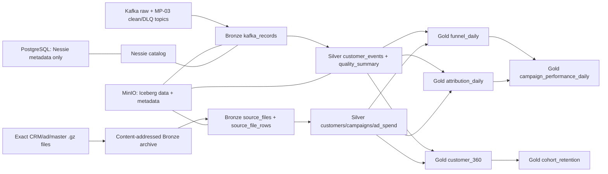

# MP-04 Bronze/Silver/Gold Lakehouse Design

## Intent

MP-04 gives MarketPulse 360 a durable analytical history. It persists the exact
stream and batch inputs in Bronze, builds governed and consent-aware Silver tables,
and publishes reproducible Gold marketing models. The milestone must prove that a
reviewer can inspect historical Iceberg snapshots and rebuild the same Gold result
from Bronze without relying on Kafka retention, Flink state, or the future app
database.

The proof is intentionally local-first. Every mandatory service runs in Docker,
uses synthetic data, and continues to work without a GCP account. BigQuery remains
an optional MP-10 comparison target.

## Goals

- Run MinIO, a persistent Iceberg catalog, and Spark through a `lakehouse` Compose
  profile.
- Preserve Kafka values byte-for-byte together with topic, partition, offset, key,
  headers, record timestamp, ingestion run, and payload hash.
- Preserve CRM, ad-report, and master-data rows with file path, row number, source
  date, file checksum, ingestion run, and canonical source payload.
- Make repeated ingestion idempotent without updating an already accepted Bronze
  record.
- Build typed Silver tables with deterministic identity, consent, and deduplication
  rules.
- Expose campaign, funnel, attribution, customer 360, and cohort Gold models.
- Record Iceberg snapshot IDs, row counts, checksums, and reconciled totals in a
  machine-readable evidence manifest.
- Demonstrate time travel and a clean rebuild from Bronze that matches a documented
  Gold snapshot.

## Non-goals

- Dagster schedules, dbt models, and ClickHouse publication belong to MP-05.
- Continuous Flink-to-Iceberg writes are not required. MP-04 consumes bounded Kafka
  offsets with Spark so the recovery and backfill proof is deterministic.
- Application accounts, roles, alerts, saved segments, and annotations remain a
  separate future PostgreSQL domain.
- Production security, multi-node Spark, object-store replication, and catalog high
  availability are outside the laptop-demo scope.
- BigQuery and BigLake are not mandatory runtime dependencies.

## Selected implementation

Use Apache Spark 4.0.4 with Apache Iceberg 1.12.0 for ingestion and transformations,
MinIO as the S3-compatible object store, and Project Nessie 0.109.0 as the Iceberg
catalog. Nessie stores only catalog/version metadata in a dedicated PostgreSQL
database through its `JDBC2` version store. This does not turn PostgreSQL into the
analytical warehouse: all table data, manifests, and Iceberg metadata remain in
MinIO.

Spark uses Iceberg's native `NessieCatalog` and `S3FileIO`. The native catalog is
chosen because its versioned-ref behavior is directly exercised by the local proof
and its Spark/Iceberg compatibility can be pinned as one tested client bundle.
Iceberg snapshot IDs provide table-level time travel; Nessie adds a persistent
versioned catalog and leaves a path to isolated branches without making branch
operations necessary for the core proof.

The Spark image is pinned to
`apache/spark:4.0.4-scala2.13-java17-python3-ubuntu` and bakes in
`iceberg-spark-runtime-4.0_2.13:1.12.0`,
`iceberg-aws-bundle:1.12.0`, and
`spark-sql-kafka-0-10_2.13:4.0.4` during its image build. Normal demo runs therefore
do not resolve dependencies from the internet. One-shot `spark-submit` containers
execute explicit commands; starting the storage services never ingests or
transforms data by surprise.

## Data flow



## Runtime topology

The Compose `lakehouse` profile adds storage/catalog services only:

- `lakehouse-postgres`: a dedicated PostgreSQL database for Nessie metadata.
- `minio`: S3-compatible object storage with API on `localhost:9000` and console on
  `localhost:9001`.
- `minio-init`: an idempotent one-shot bucket initializer.
- `nessie`: persistent catalog/API on `localhost:19120`.

Nessie's REST API is published on `19120`; its health endpoint remains internal on
management port `9000` and is used by the Compose readiness check.

The separate `lakehouse-tools` profile defines `spark-lakehouse`. Operators invoke
it with `docker compose --profile lakehouse --profile lakehouse-tools run --rm spark-lakehouse ...`;
`docker compose --profile lakehouse up -d --wait` therefore never launches a Spark
job. Spark runs as `local[2]` with UTC session time, two shuffle partitions, a 2 GiB
driver limit, and the following catalog settings:

```text
spark.sql.catalog.lakehouse=org.apache.iceberg.spark.SparkCatalog
spark.sql.catalog.lakehouse.catalog-impl=org.apache.iceberg.nessie.NessieCatalog
spark.sql.catalog.lakehouse.uri=http://nessie:19120/api/v2
spark.sql.catalog.lakehouse.ref=main
spark.sql.catalog.lakehouse.warehouse=s3://marketpulse-lakehouse/warehouse
spark.sql.catalog.lakehouse.io-impl=org.apache.iceberg.aws.s3.S3FileIO
spark.sql.catalog.lakehouse.s3.endpoint=http://minio:9000
spark.sql.catalog.lakehouse.s3.path-style-access=true
spark.sql.catalog.lakehouse.s3.region=us-east-1
```

Credentials use the AWS SDK static provider inside the isolated Compose network.
Nessie, PostgreSQL, Spark, and Alpine base images are pinned by tag. MinIO and
MinIO Client images are built for amd64/arm64 from pinned official release binaries
and verify the published SHA-256 during the build. Compose records pinned image
tags; the evidence manifest records the executing Python and Spark versions.
Resolved image digests and Nessie commit hashes are not currently evidence fields.

Local credentials are supplied by the ignored `.env` or explicit environment
variables. The committed `.env.example` leaves password fields empty; Compose
requires both PostgreSQL and MinIO passwords and the runtime has no password
fallback. Never commit credentials or reuse production values. Editing `.env`
does not rotate credentials already initialized in a persistent catalog volume.
Named volumes retain object data and catalog metadata across normal
container restarts. A third named volume gives the non-root Spark process a portable
writable location for evidence without relying on host bind-mount ownership. The
smoke test uses its own Compose project and destroys only that project's volumes.

## Bronze contracts

### `bronze.kafka_records`

One row represents one observed record from the three MP-02 raw topics,
`marketing.clean.customer-events.v1`, or
`marketing.dlq.flink-validation.v1`. Archiving both source and MP-03 products keeps
the original evidence and makes the MP-04 governed build depend on the already
proved MP-03 validation/dedup contract. `ingest_id` is SHA-256 over a canonical JSON
array `[topic,partition,offset]` and is the immutable identity used for insert-only
`MERGE`.

| Column | Type | Rule |
|---|---|---|
| `ingest_id` | string | SHA-256 of Kafka position |
| `source_topic` | string | exact input topic |
| `source_partition` | integer | non-negative |
| `source_offset` | long | non-negative |
| `kafka_timestamp` | timestamp | broker record timestamp |
| `kafka_timestamp_type` | string | `CREATE_TIME`, `LOG_APPEND_TIME`, or `NO_TIMESTAMP_TYPE` |
| `key_base64` | string nullable | exact key bytes |
| `key_sha256` | string nullable | exact-key digest |
| `headers_json` | string | ordered JSON array of `{key,value_base64}`; duplicate keys and null values preserved |
| `payload_base64` | string nullable | exact value bytes; null for tombstones |
| `payload_text` | string nullable | strict UTF-8 view when decodable; otherwise null |
| `payload_sha256` | string nullable | exact-value digest |
| `ingestion_run_id` | string | caller-provided stable run ID |
| `ingestion_manifest_sha256` | string nullable | canonical offset manifest SHA-256 on first insertion; required for evidence provenance |
| `ingested_at` | timestamp | operational load time |

The table is partitioned by `days(kafka_timestamp)`. No business parser is allowed
before the raw bytes and lineage have been written. When the same Kafka position is
seen again, all key/value/header/timestamp hashes must match or ingestion fails with
`KAFKA_POSITION_COLLISION`; a matching row is a no-op.

### Offset manifest

`capture-offsets` writes a version-1 JSON manifest containing Kafka cluster ID,
capture time, allowed topic list, and every topic-partition `[start_offset,
end_offset)` range. End offsets are exclusive. On the first ingestion, start is the
broker's earliest offset. Later captures use the largest stored Bronze offset plus
one. Missing partitions, new unapproved partitions, retention gaps, or a start
below broker earliest fail before Spark reads. `failOnDataLoss=true` remains enabled.

Re-reading the same manifest must add zero rows. Republishing the same logical
events creates new Kafka positions and therefore new Bronze rows, but MP-03/Silver
event deduplication must keep governed totals unchanged. Evidence records requested
ranges, observed min/max offsets, observed counts, and inserted counts.

### `bronze.source_files`

Before parsing, every allowlisted compressed source file and `manifest.json` is
copied byte-for-byte to
`s3://marketpulse-lakehouse/bronze/source-files/sha256=<digest>/<basename>`. This
table records `file_sha256` (key), `source_dataset`, `source_file`,
`source_object_uri`, `compressed_size_bytes`, `manifest_sha256`,
`ingestion_run_id`, and `archived_at`. A repeated digest is a no-op; the same logical
source path with different bytes is a new immutable object and is reported.

### `bronze.source_file_rows`

One row represents one record parsed from an archived source object. It stores
`ingest_id`, `source_dataset`, `source_file`, `source_object_uri`, `row_number`,
`source_date`, `file_sha256`, `payload_json`, `payload_sha256`, `ingestion_run_id`,
and `ingested_at`. The identity is SHA-256 over canonical JSON
`[file_sha256,row_number]`. Row numbers are one-based data rows and exclude a CSV
header. CSV blanks become JSON null; other CSV cells remain strings. JSONL values
must be objects and are serialized with UTF-8, sorted keys, and compact separators.
Master files have null `source_date`; dated extracts use their manifest partition
date. The table is partitioned by `source_dataset` and `source_date`.

The exact allowlist is `crm`, `google_ads`, `meta_ads`, `tiktok_ads`,
`master/ads`, `master/campaigns`, `master/customers`, and `master/products`.
Replayable web/order/email files, `quality_cases`, and `ground_truth` are excluded
from business ingestion. The original compressed objects still make vendor inputs
recoverable when local generated files are removed.

Bronze never stores application operational data and never treats `ground_truth`
as an input model. Ground truth is verifier-only evidence.

## Silver contracts and governance

### `silver.customer_events`

Parse the MP-03 `marketing.clean.customer-events.v1` records archived in Bronze and
validate the complete committed JSON Schema. The raw topics and MP-03 DLQ remain
available to reconcile the accepted set and MP-03's ten reason-code semantics.
When a logical event is republished, choose one winner by the total order
`(lineage.record_timestamp NULLS LAST, lineage.topic, lineage.partition,
lineage.offset, bronze.source_topic, bronze.source_partition,
bronze.source_offset)`. The same `event_id` with a different canonical payload hash
is an `EVENT_ID_PAYLOAD_CONFLICT`; the winner remains deterministic and the conflict
is visible in quality evidence. The comparison includes the recovered raw-envelope
`click_id` as a null-safe field alongside the clean logical payload hash.

Only rows with `consent_analytics=true` and `eligible_for_aggregates=true` enter
governed analytical models. Denied, missing-consent, or ineligible late records stay
in Bronze and are summarized; no raw data is deleted. Bot status is evaluated per
web session: if any web/mobile event has `payload.is_bot=true`, every web/mobile
event in that session is excluded from funnel and touch attribution and counted as
`BOT_EXCLUDED`. Eligible commerce rows remain in governed revenue, but an order
with only bot touches is unattributed.

The table is partitioned by `months(event_date)` and keyed by `event_id`:

| Column | Type / nullability | Derivation |
|---|---|---|
| `event_id` | string not null | MP-03 clean event ID |
| `event_name` | string not null | validated event name |
| `event_time`, `ingested_at` | timestamp not null | UTC timestamps |
| `event_date` | date not null | UTC date of `event_time` |
| `source`, `channel` | string not null | validated enums |
| `customer_id`, `anonymous_id` | string nullable | source identity |
| `profile_key` | string not null | identity stitching rule below |
| `session_id` | string not null | source session |
| `campaign_id`, `campaign_key` | string nullable | source campaign |
| `click_id` | string nullable | recovered from the original raw envelope through exact topic/partition/offset lineage and verified event identity |
| `consent_analytics` | boolean not null | must be true in this table |
| `late_status` | string not null | MP-03 classification |
| `is_bot_session` | boolean not null | session-level bot flag |
| `order_id` | string nullable | commerce payload |
| `gross_amount_minor`, `refund_amount_minor` | long nullable | commerce payload |
| `currency` | string nullable | commerce payload |
| `payload_json` | string not null | canonical original payload |
| `source_payload_sha256` | string not null | Bronze clean-record payload hash |
| `lineage_topic`, `lineage_partition`, `lineage_offset` | string/int/long not null | original raw Kafka lineage |

Identity keys are namespaced. A known customer becomes `customer:<customer_id>`.
An anonymous event is stitched to that customer when another event in the same
session contains both the same `anonymous_id` and a customer ID; otherwise it is
`anonymous:<anonymous_id>`. The final fallback is `session:<session_id>`. This rule
never merges two customers and is independent of processing order.

### `silver.customers`

Latest CRM snapshot wins by `(snapshot_date, source_file, row_number)`. Grain and
key are `customer_id`; the table is unpartitioned. Columns are `customer_id`,
`created_at`, `snapshot_date`, `loyalty_tier`, `lifetime_value_minor`, nullable
`last_order_at`, `consent_analytics`, `consent_marketing`, and source file lineage.
Email and phone fields are deliberately excluded.

### `silver.campaigns`

Grain/key is internal `campaign_id`; the table is unpartitioned. Columns are
`campaign_id`, `platform`, `platform_campaign_id`, `name`, `objective`, `status`,
`start_date`, `end_date`, `daily_budget_minor`, `currency`, `ad_count`, and source
file lineage. `platform_campaign_id` is unique and maps vendor reports to the
internal campaign ID.

### `silver.ad_spend_daily`

Grain/key is `(spend_date,campaign_id,platform)` and partitioning is
`months(spend_date)`. Columns are `spend_key`, `spend_date`, internal `campaign_id`,
`platform`, `platform_campaign_id`, `impressions`, `clicks`, `conversions`,
`spend_minor`, `conversion_value_minor`, `currency`, and source file lineage.
Google `cost_micros`, Meta decimal spend, and TikTok decimal spend are converted to
integer VND minor units by source-specific rules with half-up rounding; unsupported
currencies fail the build instead of being summed.

### `silver.quality_summary`

Grain/key is `(event_date,source_topic,reason_code)` and partitioning is
`months(event_date)`. Columns are the grain plus `record_count`,
`distinct_event_count`, and `run_id`. Reason codes include MP-03's ten validation
codes plus `DUPLICATE_EVENT`, `EVENT_ID_PAYLOAD_CONFLICT`, `CONSENT_DENIED`,
`LATE_INELIGIBLE`, `BOT_EXCLUDED`, and `ACCEPTED`.

Every Silver output is replaced atomically from its Bronze inputs for a bounded
run. Re-running with identical Bronze snapshots produces identical business rows.

## Gold models

All Gold timestamps/dates are UTC, ratios are `decimal(18,6)`, and tables include no
synthetic email address or phone token.

### `gold.funnel_daily`

Grain/key is `(event_date,campaign_id)`; partition by `months(event_date)`. Columns
are the grain, `sessions`, `page_view_sessions`, `view_item_sessions`,
`add_to_cart_sessions`, `checkout_sessions`, and `purchase_sessions`. Counts are
distinct sessions that reached each named stage; stages need not be sequential.
Campaign comes from each event, and sessions marked as bot are excluded entirely.
Rows with null campaign are emitted under `__unattributed__` so reconciliation does
not silently drop them.

### `gold.attribution_daily`

Grain/key is `(model,event_date,campaign_id)`, where model is
`first_touch|last_touch|linear`; partition by `months(event_date)`. Columns are the
grain, `is_attributed`, `allocated_order_count decimal(18,6)`,
`allocated_gross_minor`, `allocated_refund_minor`, and `allocated_net_minor`.

A paid touch is a non-bot web/mobile `page_view` with non-null `click_id` and
`campaign_id`. Touch identity is `click_id`. Candidate touches share the order's
`profile_key`, occur in `[order_time - 30 days, order_time]`, and are unique by
click ID. They order by `(event_time,campaign_id,click_id,event_id)`. First-touch
uses the first candidate, last-touch the last. Linear splits each integer monetary
value across ordered unique touches; quotient units go to every touch and the
positive remainder goes one unit at a time in chronological order. Order count is
split as fixed-scale decimal. Orders without candidates use campaign
`__unattributed__` with `is_attributed=false`.

Refund rows link to the original `order_id` and reuse that order's candidate touches
and model assignments, but are reported on the refund event date. Each attribution
model separately reconciles exact governed gross, refund, and net amounts.

### `gold.customer_360`

Grain/key is `profile_key`; unpartitioned. Columns are `profile_key`, nullable
`customer_id`, nullable `anonymous_id`, `profile_type`, `first_activity_at`,
`last_activity_at`, `event_count`, `session_count`, `order_count`, `refund_count`,
`gross_revenue_minor`, `refund_amount_minor`, `net_revenue_minor`, nullable
`acquisition_campaign_id`, `cohort_month`, and latest consent booleans when known.
Known customers use CRM `created_at` for `cohort_month`; unresolved anonymous
profiles use first eligible activity month. Anonymous buyers are retained as
profiles rather than silently excluded.

### `gold.cohort_retention`

Grain/key is `(cohort_month,activity_month,profile_type)` and partitioning is
`months(cohort_month)`. Columns are the grain plus `month_number`, `cohort_size`,
`active_profiles`, and `retained_rate decimal(18,6)`. A profile is active in a month
when it has at least one eligible, non-bot event. The cohort population contains
profiles with at least one governed event; consent is evaluated per event, so a
later opt-out cannot erase already documented historical eligibility.

### `gold.campaign_performance_daily`

Grain/key is `(event_date,campaign_id)`; partition by `months(event_date)`. It is a
full outer join of ad spend, funnel, source-attributed commerce events, and modeled
attribution. Columns include campaign/platform dimensions, impressions, clicks,
vendor conversions, spend, all funnel counts, orders, refunds, gross/refund/net
revenue, first-touch/last-touch/linear gross/refund/net revenue, and
`source_roas`, `first_touch_roas`, `last_touch_roas`, `linear_roas` as
`decimal(18,6)`. Missing additive metrics become zero. A ratio is null when spend
is zero. Currency must be one consistent value for the row.

The committed fixture has two intentionally different reconciliation layers:

| Layer | Gross minor | Refund minor | Net minor |
|---|---:|---:|---:|
| Source/MP-03 accepted events | 29,718,000 | 4,967,000 | 24,751,000 |
| Governed consent-eligible Gold | 27,160,000 | 4,967,000 | 22,193,000 |

Evidence records both. Each attribution model reconciles to the governed layer,
including `__unattributed__`. The fixture also contains three unresolved anonymous
orders totaling 4,046,000 gross minor units; `customer_360` must retain them.

## Idempotency and backfill

1. Capture a versioned Kafka `[start,end)` offset manifest and source-file checksums
   at run start.
2. Insert unseen Bronze positions/rows only; never update accepted Bronze data.
3. Record the Bronze snapshot IDs used for the build.
4. Build Silver and Gold with deterministic ordering and no processing-time fields
   in business equality checks.
5. Record each output snapshot ID, row count, canonical business checksum, and
   reconciled monetary totals in `lakehouse-evidence.json`.
6. Prove no-op idempotency by re-reading the same manifests. Build Silver and Gold
   again from the same pinned inputs to create distinct later output snapshots.
7. Query the recorded baseline snapshot after the later snapshot exists.
8. Recreate Silver and Gold only in namespace `rebuild_<run_id>_<identity>` from the recorded
   Bronze snapshot IDs and compare schemas, rows, checksums, and reconciliations.

The proof compares complete canonical rows excluding Iceberg operational metadata;
matching only counts is insufficient. Spark timezone is UTC. The checksum algorithm
is version `canonical-json-rowset-v1`:

1. Read the physical Iceberg schema as an ordered `{name,type,nullable}` array,
   normalize equivalent type names, verify it against the table contract, and
   SHA-256 its compact sorted-key JSON encoding.
2. Project only the contract's ordered business columns. Encode each row as a JSON
   array. Normalize timestamps as UTC RFC 3339 with six fractional digits and `Z`,
   dates as ISO 8601, decimals at their declared scale, binary as base64, and null as
   JSON null.
3. Sort encoded row bytes lexicographically. Hash the concatenation of an unsigned
   eight-byte big-endian length followed by each row's bytes.

### Evidence manifest

`lakehouse-evidence.json` uses schema version `1` and contains:

- run ID, created time, optional Git commit, catalog ref, and executing Python/Spark
  versions;
- embedded offset and file manifests with content hashes, exact ranges and Bronze
  snapshot IDs; ingestion commands separately report requested/observed/inserted
  counts and archived-object results;
- for every Silver/Gold table: fully qualified name, Iceberg snapshot ID, ordered
  schema fingerprint, row count, checksum algorithm/version, business columns, and
  canonical checksum;
- accepted, duplicate, payload-conflict, consent-denied, late-ineligible, bot, and
  validation reason counts;
- source and governed gross/refund/net totals plus per-model attribution totals;
- original/rebuild namespace and comparison result for every table.

Operational columns excluded from equality are `ingested_at`, `processed_at`,
`archived_at`, `run_id`, Iceberg file paths, snapshot timestamps, and physical
partition/file metadata. All other contract columns are checksum inputs.

## Commands and operator experience

The single Python entry point supports:

```text
marketpulse-lakehouse bootstrap
marketpulse-lakehouse capture-offsets --run-id <id> --output <offsets.json>
marketpulse-lakehouse ingest-kafka --run-id <id> --offset-manifest <offsets.json>
marketpulse-lakehouse ingest-files --run-id <id> --input <fixture-or-generated-root>
marketpulse-lakehouse build --run-id <id> --bronze-snapshots <snapshots.json>
marketpulse-lakehouse verify --evidence <path>
marketpulse-lakehouse backfill-proof --evidence <path>
```

The Docker smoke wrapper starts an isolated streaming + Flink + lakehouse storage
stack, publishes the fixture through the existing replay tool, waits for MP-03
clean/DLQ output, archives bounded raw/clean/DLQ topics, stops Flink to release
laptop memory, then runs the commands above. Before governance, it compares the
Spark accepted event set and source totals with MP-03 output; after governance it
explains the consent and bot exclusions. It prints the evidence path and UI URLs
and exits non-zero on any schema, checksum, consent, deduplication, attribution,
snapshot, parity, or backfill mismatch.

## Verification strategy

- Pure Python unit tests cover table contracts, deterministic ingest identities,
  canonical checksums, consent/identity decisions, attribution remainder handling,
  and evidence comparisons.
- Docker asset tests render Compose, inspect pinned images/configuration, and run
  entry-point validation without external services.
- Spark integration tests use the real Iceberg catalog and MinIO, not Parquet-only
  substitutes.
- The real smoke test checks byte preservation for sampled Kafka rows, exact
  compressed file recovery, MP-03 accepted-set parity, duplicate immunity, consent
  and bot exclusion, both fixture revenue layers, all five Gold model schemas,
  snapshot time travel, catalog restart persistence, and rebuild equality.

## Failure behavior

- Unsupported schemas, malformed JSON, invalid timestamps, missing identities, and
  event-ID payload conflicts are counted in `silver.quality_summary`; their Bronze
  rows remain intact.
- A missing topic, bucket, catalog, or source manifest fails before a transform.
- Kafka partition drift, retention gaps, position-content collisions, and observed
  counts outside the captured ranges fail ingestion.
- A source-file checksum mismatch fails ingestion rather than silently producing a
  new identity for corrupted content.
- Gold publication is never reported successful until evidence is written and read
  back from the local filesystem.
- Backfill writes to isolated tables and cannot overwrite the documented snapshot.

## Significant implementation calls

- Spark owns MP-04 bounded archival/transforms while MP-03 Flink remains the live
  validation/dedup processor. Bronze archives both raw and clean/DLQ products, and
  Silver consumes the proved MP-03 clean contract.
- PostgreSQL is catalog metadata only, preserving the architecture boundary that it
  is not the analytical warehouse.
- Native Nessie catalog is selected for pinned Spark versioned-ref behavior; Iceberg
  REST remains a valid later portability option.
- Bronze stores exact Kafka bytes in base64 in addition to a nullable UTF-8 view.
- Business checksums exclude processing time and physical file layout, making the
  backfill proof stable across Spark task scheduling.
